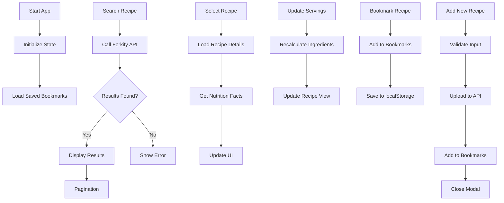
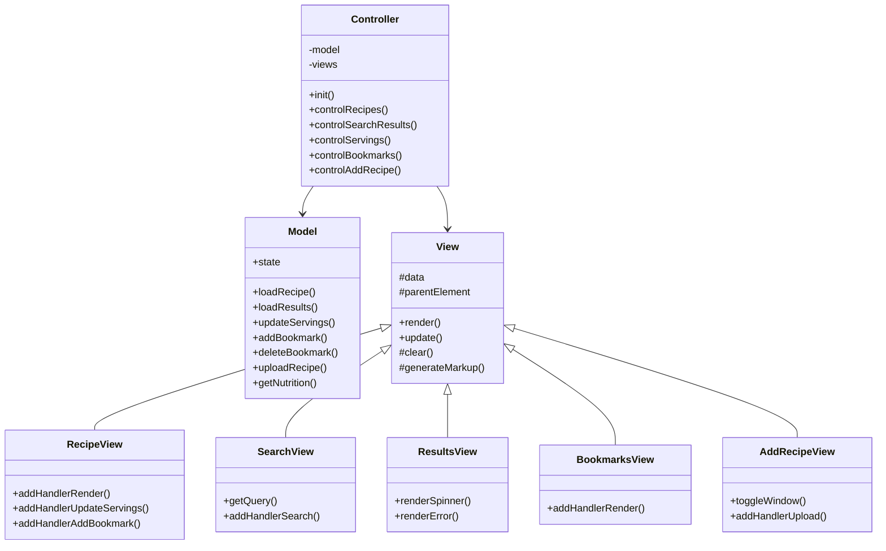

<div id="top"></div>


<br />
<div align="center">
  <a href="https://forkify-v2-kpszq0s62-eslamomar5012s-projects.vercel.app/">
    
  </a>
  <h1 align="center">Forkify V2</h1>
  <p align="center">
    <a href="https://forkify-v2-kpszq0s62-eslamomar5012s-projects.vercel.app/">View Demo</a>
  </p>
</div>

<details>
  <summary>Table of Contents</summary>
  <ol>
    <li>
      <a href="#about-the-project">About The Project</a>
      <ul>
        <li><a href="#features">Features</a></li>
        <li><a href="#built-with">Built With</a></li>
        <li><a href="#flowchart">Flowchart</a></li>
        <li><a href="#architecture">Architecture</a></li>
      </ul>
    </li>
    <li>
      <a href="#getting-started">Getting Started</a>
      <ul>
        <li><a href="#installation">Installation</a></li>
        <li><a href="#tree-structure">Tree Structure</a></li>
      </ul>
    </li>
    <li><a href="#usage">Usage</a></li>
    <li><a href="#contributing">Contributing</a></li>
    <li><a href="#acknowledgments">Acknowledgments</a></li>
  </ol>
</details>

## About The Project

Forkify V2 is a modern recipe web app that lets users search, view, bookmark, and add recipes. It uses the [Forkify API](https://forkify-api.herokuapp.com/v2) and calculates nutrition facts via the USDA FoodData Central API.

- Available search queries: [Queries](https://forkify-api.herokuapp.com/phrases.html)

### Features

| User Stories                                                               | Features                                                                                                                                                                              |
| -------------------------------------------------------------------------- | ------------------------------------------------------------------------------------------------------------------------------------------------------------------------------------- |
| Search for recipes                                                         | <ul><li>Search input to query API<li>Paginated results<li>Recipe details: cooking time, servings, ingredients</ul>                                                                   |
| Update the number of servings                                              | <ul><li>Change servings: updates ingredient quantities</ul>                                                                                    |
| Bookmark recipes                                                           | <ul><li>Bookmark recipes: view and manage favorites</ul>                                                                                       |
| Create recipes                                                             | <ul><li>Upload your own recipes<li>Auto-bookmark user recipes<li>User can only see their own recipes</ul>                                      |
| Persistent bookmarks                                                       | <ul><li>Bookmarks stored in localStorage</ul>                                                                                                  |
| Nutrition facts                                                            | <ul><li>Nutrition calculated via USDA API</ul>                                                                                                 |

<p align="right">(<a href="#top">back to top</a>)</p>

---

### Built With

- HTML
- CSS / SASS
- JavaScript
- Parcel
- Babel
- Forkify API
- USDA FoodData Central API
- fractional (library)

---

### Flowchart



### Architecture



<p align="right">(<a href="#top">back to top</a>)</p>

---

## Getting Started

You can view the app online using this [demo](https://forkify-gray.vercel.app) or follow the instructions below to run locally.

### Installation

1. Clone the repo
   ```sh
   git clone https://github.com/EslamOmar5012/forkify.git
   ```
2. Go to project folder
   ```sh
   cd forkify
   ```
3. Install dependencies
   ```sh
   npm install
   ```
4. Start the development server
   ```sh
   npm start
   ```

### Tree Structure

```
Forkify-V2
│   .gitignore
│   .prettierrc
│   index.html
│   package-lock.json
│   package.json
│   README.md
│
└───src
    ├───img
    │       favicon.png
    │       forkify-architecture-recipe-loading.png
    │       forkify-flowchart.png
    │       icons.svg
    │       logo.png
    │       preview.png
    │
    ├───JS
    │   │   config.js
    │   │   controller.js
    │   │   helpers.js
    │   │   model.js
    │   │
    │   └───views
    │           addRecipeView.js
    │           bookmarksView.js
    │           paginationView.js
    │           previewView.js
    │           recipeView.js
    │           resultsView.js
    │           searchView.js
    │           View.js
    │
    └───scss
            style.scss
            _nav-bar.scss
            _recipe.scss
            _search-results.scss
            _modal.scss
            _bookmarks.scss
```

<p align="right">(<a href="#top">back to top</a>)</p>

---

## Usage

- **Search:** Enter keywords in the search bar to find recipes.
- **View Recipe:** Click a result to see details, ingredients, and nutrition facts.
- **Bookmark:** Click the bookmark icon to save a recipe.
- **Add Recipe:** Use the modal form to submit your own recipe.
- **Change Servings:** Adjust servings to update ingredient quantities.
- **Nutrition:** Nutrition facts are fetched automatically for each recipe.

---

## Contributing

Contributions are welcome! Please fork the repo and submit a pull request, or open an issue for suggestions.

1. Fork the Project
2. Create your Feature Branch (`git checkout -b feature/AmazingFeature`)
3. Commit your Changes (`git commit -m 'Add some AmazingFeature'`)
4. Push to the Branch (`git push origin feature/AmazingFeature`)
5. Open a Pull Request

<p align="right">(<a href="#top">back to top</a>)</p>

---

## Acknowledgments

- [Jonas Schmedtmann](https://github.com/jonasschmedtmann)
- [Forkify API](https://forkify-api.herokuapp.com/v2)
- [USDA FoodData Central API](https://fdc.nal.usda.gov/)

<p align="right">(<a href="#top">back to top</a>)</p>


